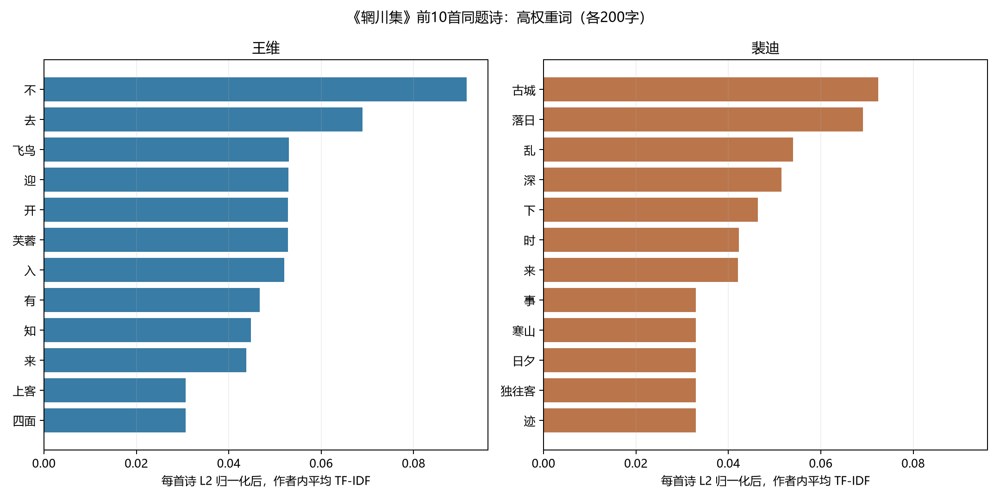

# 王维与裴迪《辋川集》同题诗的文本特征比较

## 1. 语料与可比性

选取两位作者《辋川集》按原集次序排列的前10首，而非按预期风格挑选作品。共20首，每首4句、每句5字，正文均20字，各作者200字。题目依次为：孟城坳、华子冈、文杏馆、斤竹岭、鹿柴、木兰柴、茱萸沜、宫槐陌、临湖亭、南垞。体裁统一为五言绝句，同题配对控制地点与题材，属于同一唱和组诗语境；未逐首确定创作年份，不能宣称精确年代完全相同。前半集亦不是随机样本。

2026年11月13日核对维基文库正文（古典诗作属于公有领域）：

- [王维《辋川集》](https://zh.wikisource.org/w/index.php?title=輞川集_(王維)&oldid=1981895)
- [裴迪《辋川集》](https://zh.wikisource.org/w/index.php?title=輞川集_(裴迪)&oldid=1981972)

不纳入题目、作者、序言及异文注释。人工转为简体，另将“暎→映、谿→溪、篠→筱、埽→扫”等统一；保留“返景、裴回、森沈、麏麚”等原词，不改为现代惯用写法。王维“芙蓉杯”保留底本文字，不采用注释中的“茱萸杯”；“上客”亦不改为异文“仙客”。这些选择会影响结果。完整正文及每首分词均保存在语料与分词.json，构成此次分析的固定输入。

## 2. 分词与计算设置

采用可逐词复核的人工分词，不使用面向现代汉语的自动分词器。两作者统一规则：逐句切分，不跨句；景物名词、常见双音词和完整专名尽量保留，例如“飞鸟、深林、古城、南垞”；独立动词、否定、方位和程度成分可保留单字。按语境切分“时／分明”与“何时”，不强行固定字数切分。人工判断有主观性，例如“独往客、商山路”也存在其他切法，因此本结果不等于唯一正确的词汇划分。

统一停用词：为、复、且、如、更、此、与、已、但、便、虽、犹、自、是、之、其、而、也、乎。保留“不、无、有、来、去”等具有否定、存在或运动意义的词；未在看到排名后删除单字词。标题不入模，但正文实际出现的地名保留。

用 sklearn TfidfVectorizer 在全部20首诗上一次性拟合。每首诗是一篇文档，不将每位作者拼成一篇。参数：tokenizer=str.split，token_pattern=None，lowercase=False，min_df=1，max_df=1.0，ngram_range=(1,1)，sublinear_tf=False，smooth_idf=True，norm='l2'。词表207项。

计算公式：idf(t)=ln[(1+20)/(1+df(t))]+1；词频使用原始次数，每首诗的TF×IDF向量再做L2归一化。将作者10首诗向量取平均（未出现的词记0），得到作者平均权重。图展示各作者前12项，并列时按词的Unicode顺序排列；截断可能隐藏同分词，完整CSV保留全部词。权重不是概率，也不是显著性或风格强度。

## 3. 关键词与主题线索

| 作者 | 高权重词及平均值 | 可供细读的线索 |
|---|---|---|
| 王维 | 不0.0915；去0.0689；飞鸟0.0531；迎0.0529；开0.0528；芙蓉0.0528 | 否定与感知、移动、鸟与植物、迎客 |
| 裴迪 | 古城0.0724；落日0.0691；乱0.0540；深0.0515；下0.0464；时0.0422 | 城址、暮景、景物交错与空间深度 |

主题标签为阅读后的人工概括，并非主题模型输出。作者内部高权重也不自动等于作者间独有词；CSV同时列出两作者均值及其差值，便于检查共享词。

## 4. 原文抽查记录

抽查采用有目的覆盖：重复景物词、最高权重词、单字词、异文及多义词，非随机抽样。下列原句均回到上述来源页面核对；没有进行纸本版本校勘。

| 作者／词 | 原文位置与句子 | 核查结论及限制 |
|---|---|---|
| 王维／不 | 《华子冈》“飞鸟去不穷”；《鹿柴》“空山不见人” | 前者指运动无尽，后者否定可见的人；不能统一解释为悲观情绪。该词在王维5首、裴迪1首出现。 |
| 王维／飞鸟 | 《华子冈》“飞鸟去不穷”；《木兰柴》“飞鸟逐前侣” | 两首均为鸟的动态描写，可支持局部意象观察；不能由此证明作者整体更关注动物。 |
| 王维／芙蓉 | 《茱萸沜》“置此芙蓉杯”；《临湖亭》“四面芙蓉开” | 前例修饰酒杯，后例为花景；同词不能全部计作真实植物出现。前例还有“茱萸”异文。 |
| 王维／迎 | 《宫槐陌》“应门但迎扫”；《临湖亭》“轻舸迎上客” | 后例明确迎客，前例须结合“畏有山僧来”理解；不可只按一个动词判定相同社交态度。 |
| 裴迪／古城 | 《孟城坳》“结庐古城下，时登古城上。古城非畴昔，今人自来往。” | 同一首重复3次，文档频数仅1；高权重主要来自局部复沓，不能视作跨篇稳定主题。 |
| 裴迪／落日 | 《华子冈》“落日松风起”；《木兰柴》“苍苍落日时”；《南垞》“落日下崦嵫” | 分布在3首，比“古城”更有跨篇依据；但王维“余照、夕岚、返景”提示相近暮光意象可能被不同词形分散。 |
| 裴迪／乱 | 《木兰柴》“鸟声乱谿水”；《茱萸沜》“飘香乱椒桂” | 分别关联声音与香气，不能机械归入社会混乱或心理焦虑；分析文本统一谿为溪。 |
| 裴迪／深 | 《斤竹岭》“绿篠密复深”；《木兰柴》“缘谿路转深” | 分别涉及竹丛与路径空间；“深林”作为整体词另计，不应把“深”的排名当成全部深幽意象的频率。 |

## 5. 约150字解释

在这组同题、等长的诗歌中，王维的“飞鸟”“芙蓉”与裴迪的“落日”“古城”形成不同的词汇线索，可支持对局部景物描写和表达方式的比较。但“古城”仅在一首中重复，“芙蓉”又有器物修饰与花景之别，高权重不等于稳定主题。样本只覆盖组诗前半，分词、停用词和异文处理也会改变排序，因此不能据此证明两位作者的整体风格、人格或文学价值高下。

## 6. 方法边界与复现

本任务回答“在指定语料和统一规则下，哪些词获得较高权重”，再靠原文细读确认语境。古籍植物知识挖掘关注植物名称、知识及其组织；提示式临床量表信息抽取关注将文本映射到预定义字段。三者研究对象、输出与评价单位不同，不能直接用结果比较方法优劣。这里未取得题目列出的两篇论文全文，以上仅作任务层级区分，不冒充对两篇论文具体实验设计或结论的评述。

复现：安装 scikit-learn、numpy、matplotlib 后，在本目录运行 `python analyze.py`。脚本包含固定语料与人工分词，生成JSON、完整CSV、停用词文件、图及运行环境版本记录。已执行20首、每首4×5字校验，并检查图中文字与坐标可读。未做显著性检验、外部验证或分词敏感性实验，结果属于探索性描述。
